# Sensor Widgets

[](https://github.com/mgasc/InfluxDBWidget/actions/workflows/ci.yml)
[](https://github.com/mgasc/InfluxDBWidget/actions/workflows/release.yml)
[](https://opensource.org/licenses/MIT)

**Sensor Widgets** is a privacy-first, open-source mobile app for Android and iOS that serves as a settings and configuration dashboard for native home-screen widgets directly querying InfluxDB.

Unlike generic widget frameworks that require the main app to run in the background, native widgets in **Sensor Widgets** query InfluxDB directly over its v1-compatible HTTP API (`/query`) using lightweight background execution (Android Jetpack Glance with WorkManager, and iOS WidgetKit with AppIntents).

---

## Features

### 6 Native Home-Screen Widget Types
1. **Single Value:** Displays the latest metric value with customizable decimal places, unit, and threshold-based status colors.
2. **History Chart:** Shows a smooth sparkline/area time-series trend line for selectable time windows (e.g. 1h, 6h, 24h, 7d, 30d).
3. **Indicator Lamp:** A clear status indicator lamp evaluating numeric thresholds (`>` or `<`) with glowing active/inactive colors.
4. **Gauge Bar:** A horizontal bar / gauge meter showing values relative to defined minimum and maximum bounds.
5. **Aggregate:** Displays summary metrics (`MIN`, `AVG` / `MEAN`, `MAX`) calculated over a given period.
6. **Multi Value:** Combines several fields from the same measurement into a compact table (as many rows as the widget size allows).

| Single Value | History Chart |
| :---: | :---: |
| 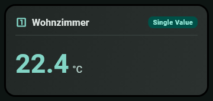 | 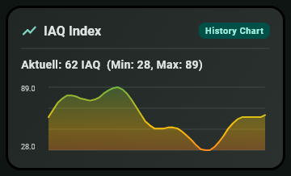 |
| **Indicator Lamp** | **Gauge Bar** |
| 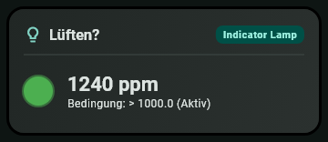 | 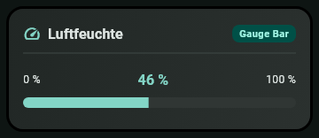 |
| **Aggregate** | **Multi Value** |
| 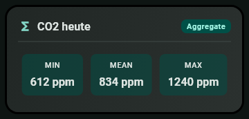 | 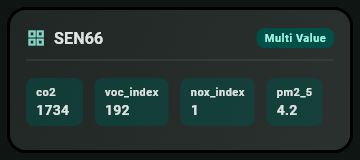 |

### Configuration Dashboard
- **Connection Management:** Manage multiple InfluxDB instances (Cloud TSM, Cloud Serverless, self-hosted v1/v2/v3). Includes live connection testing.
- **Schema Discovery:** Automatically queries `SHOW MEASUREMENTS`, `SHOW FIELD KEYS`, `SHOW TAG KEYS`, and `SHOW TAG VALUES` for auto-complete assistance, with seamless manual free-text override.
- **Live Preview:** See real-time data previews in the widget editor before adding the widget to your home screen.
- **Home-Screen Binding:** Native selection activity (Android) and AppIntents `WidgetConfigurationIntent` with `EntityQuery` (iOS 17+) allowing direct widget assignment.

---

## Getting Started

### 1. Add your InfluxDB
Open the connections screen (top right icon), tap **+** and enter name, host URL, database / bucket and API token. **Test Connection** checks the credentials before you save. The token is stored only in the device's secure storage.

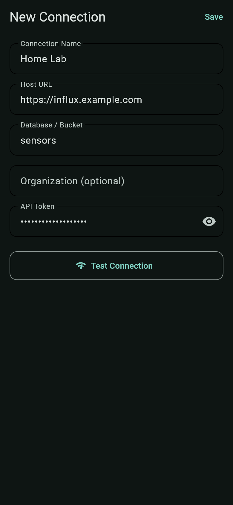

### 2. Create a widget
Tap **+** on the dashboard, give the widget a title, pick the connection and one of the six widget types. Measurement and field come from schema discovery (or type them in). **Vorschau laden** shows live data exactly as the home-screen widget will.

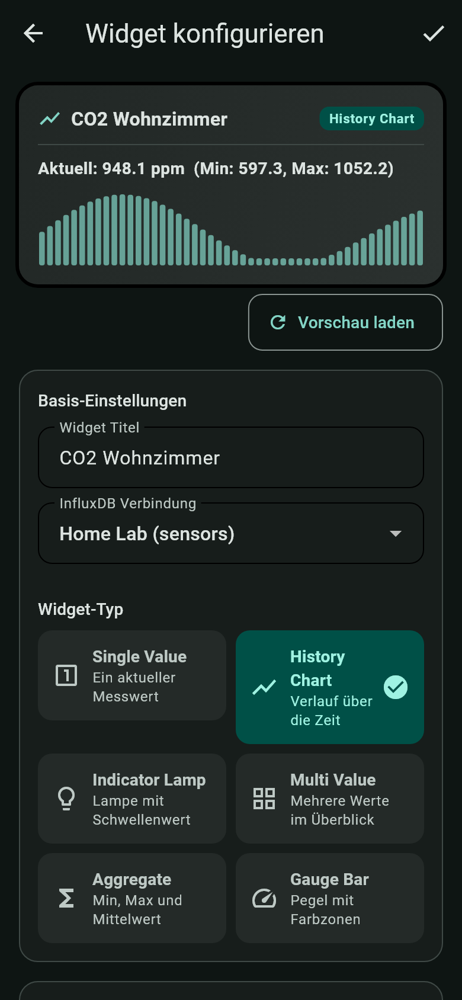 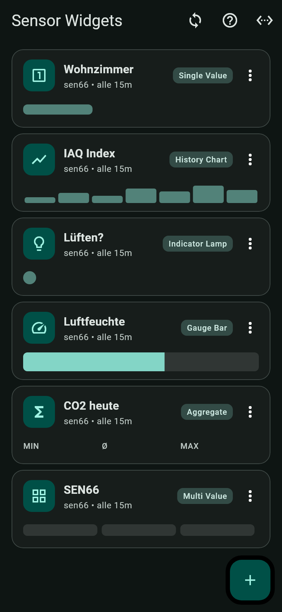

### 3. Calculate values with formulas
Switch on **Berechnungsformel verwenden** to combine several fields before they are shown: `+ - * /`, comparisons, `min`, `max`, `clamp`, `abs`, `round`, constants and named intermediate steps. The help screen (**?**) explains every function and offers ready-made templates, such as an air-quality index for the Sensirion SEN66. Map each template variable to one of your fields and the preview shows the calculated curve.

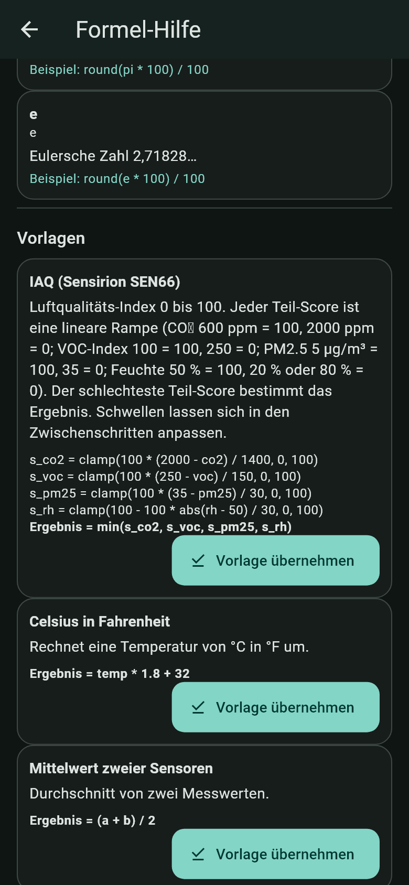 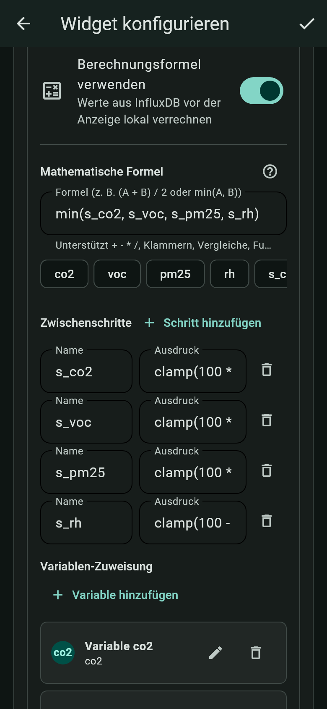 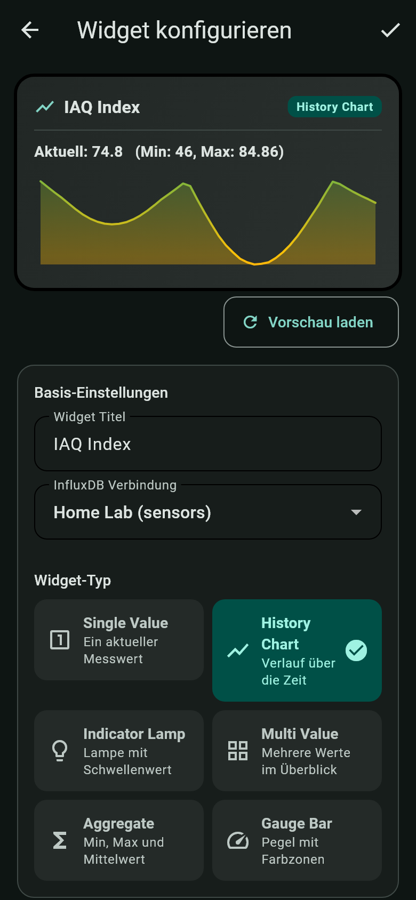

### 4. Place it on the home screen
Long-press the home screen, add the **Sensor Widgets** widget and pick your widget in the selection list (Android) or the widget settings (iOS). Resize it freely; the content scales with the widget.

> The screenshots show the app's own previews with demo data. They are generated automatically from `screenshot_test/` (see [Regenerating the screenshots](#regenerating-the-screenshots)).

---

## Architecture & Security

```
+--------------------------------------------------------------+
|                    Flutter App (Dashboard)                   |
|  - Connection Manager (URL, Database, Token)                |
|  - Widget Configurator (Type, Measurement, Tags, Thresholds) |
+------------------------------+-------------------------------+
                               |
               Persists Config & Metadata
                               v
+--------------------------------------------------------------+
|                     Shared Storage Layer                     |
|  - Shared Prefs / App Group: widget_definitions_v1 (JSON)   |
|  - Shared Prefs / App Group: connections_metadata_v1 (JSON)  |
|  - Encrypted / Keychain:     influx_token_<id> (Secure)      |
+------------------------------+-------------------------------+
                               |
               Reads Config & Authenticates
                               v
+------------------------------+-------------------------------+
|         Android (Glance)     |        iOS (WidgetKit)        |
|  - WorkManager Background    |  - TimelineProvider           |
|  - Direct InfluxQL query     |  - Direct InfluxQL query      |
|  - Native Canvas & Sparkline |  - Swift Charts & SwiftUI     |
+------------------------------+-------------------------------+
                               |
                     HTTP GET /query?db=&q=
                               v
                  +--------------------------+
                  |    InfluxDB v1/v2/v3     |
                  +--------------------------+
```

### Privacy & Security Guarantee
- **No intermediary backend:** All network traffic travels directly between your device and your configured InfluxDB instance.
- **Secure Token Storage:** API tokens are stored securely in Android `EncryptedSharedPreferences` and iOS App Group Keychain (`kSecClassGenericPassword`).
- **Token Redaction:** All error handlers, query loggers, and exception types sanitize sensitive tokens with `***`.
- **Offline Resilience:** Native widgets cache the most recent reading in shared local storage (`widget_cache_<id>`) and display cached data gracefully during network dropouts.

---

## Building and Releases

### Prerequisites
- **Flutter:** 3.47.9+ (Dart 3.13.7+)
- **Java:** OpenJDK 17
- **Android SDK:** Compile SDK 36, Min SDK 26

### Local Development & Testing

```bash
# Get dependencies
flutter pub get

# Run all Flutter tests (unit, widget, E2E)
flutter test

# Run Android unit tests & ktlint
cd android
./gradlew test
./gradlew :app:ktlintCheck
cd ..

# Build release APK locally
flutter build apk --release
```

### GitHub Actions CI/CD
- **`ci.yml`:** Automatically tests Dart, runs Ktlint and Android JUnit tests, builds release APK check, and executes SwiftLint and Swift unit tests against shared fixtures on `macos-latest`.
- **`release.yml`:** Triggers when pushing a git tag (e.g. `git tag v1.0.0 && git push origin v1.0.0`) or manually via GitHub Actions workflow dispatch. Builds the production APK, calculates SHA-256 checksums, and attaches the APK directly to the GitHub Release.
- **`screenshots.yml`:** Manual (**Actions → Screenshots → Run workflow**). Regenerates all README screenshots and commits them when they changed.

### Regenerating the screenshots
The images in `docs/screenshots/` are rendered headlessly by Flutter widget tests in `screenshot_test/` (demo data, no device or emulator needed). Locally:

```bash
flutter test screenshot_test
```

Or run the **Screenshots** workflow on GitHub. To add a screen, add a test to `screenshot_test/readme_screenshots_test.dart` and reference the new PNG here.

---

## Documentation

Comprehensive project documentation is available in [`docs/`](docs/):
- [`docs/architecture.md`](docs/architecture.md) – Detailed architectural specifications and storage keys.
- [`docs/testing.md`](docs/testing.md) – Testing strategy across Dart, Kotlin, and Swift.
- [`docs/conventions.md`](docs/conventions.md) – Conventions for InfluxQL queries, JSON contracts, and fixtures.
- [`docs/code-style.md`](docs/code-style.md) – Formatting rules, linters, and style guidelines.
- [`docs/project-brief.md`](docs/project-brief.md) – Project vision and initial requirements.
- [`Roadmap/README.md`](Roadmap/README.md) – Sequential roadmap memory and task tracking.

---

## License

This project is licensed under the [MIT License](LICENSE).
